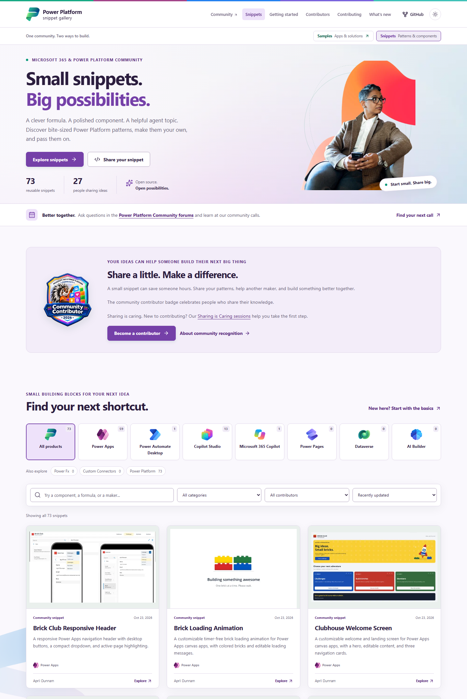
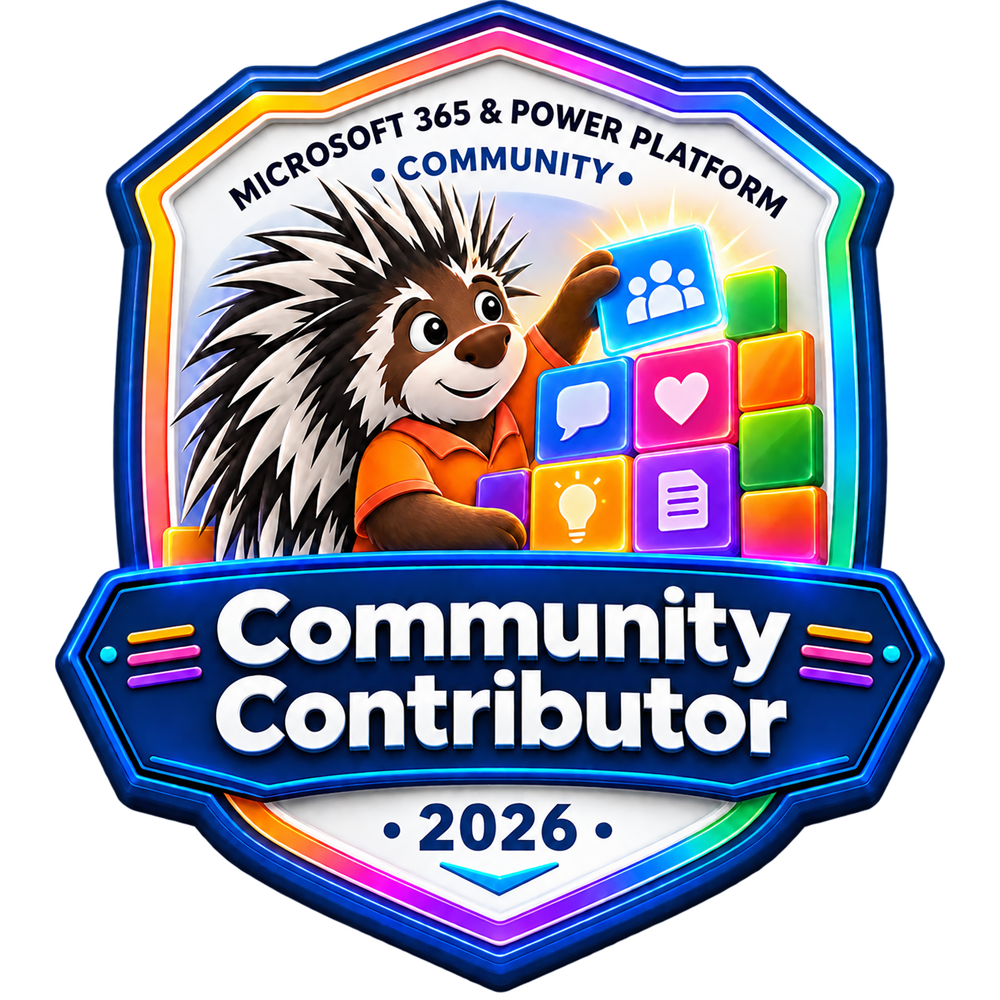

# Power Platform Snippets

**Small snippets. Big possibilities.**

Discover reusable UI patterns, Power Fx techniques, agent topics, and desktop automation building blocks for Microsoft Power Platform. Find the little piece your idea is missing, understand how it works, and make it your own.

**[Explore the snippet gallery](https://pnp.github.io/powerplatform-snippets/)** | **[Get started](https://pnp.github.io/powerplatform-snippets/getting-started/)** | **[Share your snippet](https://pnp.github.io/powerplatform-snippets/contributing/)**

## One community. Two ways to build.

- **[Power Platform Snippets](https://pnp.github.io/powerplatform-snippets/):** focused patterns, components, formulas, and topics you can reuse in your own work.
- **[Power Platform Samples](https://pnp.github.io/powerplatform-samples/):** community-built apps, automations, agents, and solutions that show how the pieces come together. Visit the [samples repository](https://github.com/pnp/powerplatform-samples) for the source.

The galleries share a familiar browsing experience while keeping their own identities: purple building blocks here, teal apps and solutions in the sample gallery.

## Find your next building block

Browse the [gallery](https://pnp.github.io/powerplatform-snippets/) by product, category, or contributor, or explore the source folders:

| Product | Snippet source |
| --- | --- |
|  Copilot Studio | [Agent topics and actions](./copilot-studio/) |
|  Power Apps | [UI components, formulas, and patterns](./power-apps/) |
|  Power Automate Desktop | [Desktop automation patterns](./power-automate-desktop/) |
|  Power Pages | [Power Pages snippets](./power-pages/) |

1. **Find your shortcut.** Open a snippet to see its preview, authors, source, and original README.
2. **Understand the pattern.** Review setup instructions, permissions, licensing, connectors, and experimental features.
3. **Adapt and test.** Follow the snippet's instructions in a development environment. Preserve attribution and share what you learn.

Each snippet's README is the authoritative guide. Snippets are shared as is, not as supported production applications.

## Sharing is caring

A small contribution can save another maker hours. Share a useful snippet, extend an existing pattern, improve documentation, or present a community demo.

Start with the [contribution guide](./CONTRIBUTING.md) and the [README templates](./templates/README.md). New to GitHub or pull requests? The community's [Sharing is Caring sessions](https://pnp.github.io/sharing-is-caring/) provide hands-on guidance for first-time contributors.

### Community contributor badge

The community contributor badge celebrates people who share their knowledge. Learn about [community recognition](https://aka.ms/community/recognition) and how to take part.

Meet the people sharing their patterns on the gallery's [Contributors page](https://pnp.github.io/powerplatform-snippets/contributors/).

## Ask, learn, and connect

- [Power Platform Community forums](https://community.powerplatform.com/): our primary place for product and how-to questions.
- [Copilot, Microsoft 365 & Power Platform Community](https://aka.ms/community/home): resources, learning opportunities, and ways to get involved.
- [Weekly community calls](https://aka.ms/community/calls): everyone is welcome. Download the recurring invites.
- [Present a community demo](https://aka.ms/community/request/demo): show your snippet and explain what you learned.
- [Microsoft Community Learning](https://www.youtube.com/@MicrosoftCommunityLearning) and [Microsoft Power Platform](https://www.youtube.com/@mspowerplatform): recordings, demos, and product videos.
- [Report a reproducible snippet bug](https://github.com/pnp/powerplatform-snippets/issues/new/choose): include the snippet name and reproduction steps.

## Run the gallery locally

The gallery is generated from every snippet's metadata and README. See the [site guide](./site/README.md) for local development, validation, and GitHub Pages publication.

## Code of Conduct

This repository has adopted the [Microsoft Open Source Code of Conduct](https://opensource.microsoft.com/codeofconduct/). See the [Code of Conduct FAQ](https://opensource.microsoft.com/codeofconduct/faq/) or contact [opencode@microsoft.com](mailto:opencode@microsoft.com) with questions or comments.

> Sharing is caring.
