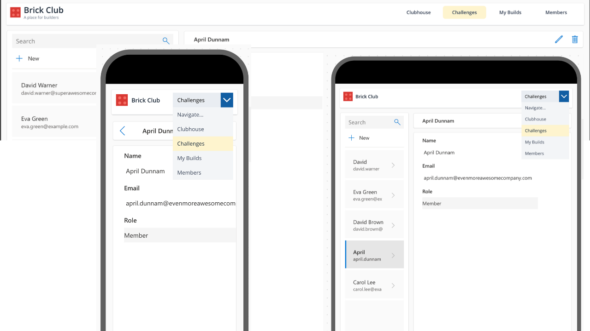

# Brick Club Responsive Header

A responsive navigation header for Power Apps canvas apps. At widths of 960 pixels and above, it displays the Brick Club brand, a subtitle, and four navigation buttons. Below 960 pixels, the buttons are replaced by a dropdown beside the brand, keeping navigation on one row.

The header uses native shapes and classic controls, with no external images or connectors. It includes active-page highlighting, hover and focus states, and notification placeholders so you can paste it without creating destination screens first.



Only the header is included in this snippet; the surrounding app and device frames in the screenshot are not included.

## Authors

Snippet | Author(s)
--------|----------
Brick Club Responsive Header | [April Dunnam](https://github.com/aprildunnam)

## Minimal path to awesome

1. Open your canvas app in **Power Apps Studio**.
1. Under **Settings > Display**, turn **Scale to fit** off so the header responds to its parent's width.
1. Copy the entire contents of [brick-club-responsive-header.yaml](./source/brick-club-responsive-header.yaml).
1. In the **Tree view**, right-click the screen or parent container where you want the header and select **Paste** (or **Paste code**, depending on your Studio version).
1. If you use an outer header container, set its height to **104**, its top and bottom padding to **0**, and **Flexible height** to **Off**. Keep flexible height off for `conBrickHeader` when placing it in a vertical auto-layout container.
1. Preview the app and resize it to see the desktop buttons change to a compact dropdown.
1. Select a navigation item to see its placeholder notification, then replace the placeholders as described below.

### Layout requirements

The supported minimum parent width is **280 pixels**. The root container fills its parent's width and uses `Min(104, Parent.Height)` for its height. The recommended outer height is **104 pixels**, with a supported minimum of **64 pixels**.

The breakpoint is based on the header's parent width, not the device type: **960 pixels or wider** shows the buttons and subtitle; **less than 960 pixels** shows the dropdown and hides the subtitle.

### Connect navigation

The snippet uses `varBrickActivePage` to highlight the selected desktop button. It defaults visually to `"Home"` until a navigation action sets the variable.

Replace the `Notify(...)` call in each desktop button's **OnSelect** with `Navigate(...)` using a screen that exists in your app. Keep the preceding `Set(...)` statement. For example, after creating a screen named `scrChallenges`, use:

```powerfx
Set(varBrickActivePage, "Challenges");
Navigate(scrChallenges, ScreenTransition.None)
```

Make the equivalent replacements in the **OnChange** formula of `drpBrickMobileNav`. The labels and active-page values map as follows:

Navigation label | Active-page value
-----------------|------------------
Clubhouse | `"Home"`
Challenges | `"Challenges"`
My Builds | `"Builds"`
Members | `"Members"`

If you reuse the header on multiple screens, set the appropriate active-page value in each screen's **OnVisible** formula so the highlight also stays correct when users arrive through other navigation paths.

To allow users to select the same dropdown destination again after returning to a screen, reset that screen's dropdown in **OnVisible**:

```powerfx
Reset(drpBrickMobileNav)
```

Use the actual control name if Studio renames it when pasting additional copies.

### Customize the header

Change `lblBrickTitle.Text` and `lblBrickSubtitle.Text` to update the brand. Customize the button labels and dropdown items together, and update their corresponding navigation formulas. The brick icon is built from a rectangle and four circles, so no image asset is required at runtime.

For reuse as a canvas component, enable access to app scope if retaining the global `varBrickActivePage` variable, and adapt navigation to the app's screens or your component's behavior properties.

## Disclaimer

**THIS CODE IS PROVIDED *AS IS* WITHOUT WARRANTY OF ANY KIND, EITHER EXPRESS OR IMPLIED, INCLUDING ANY IMPLIED WARRANTIES OF FITNESS FOR A PARTICULAR PURPOSE, MERCHANTABILITY, OR NON-INFRINGEMENT.**


