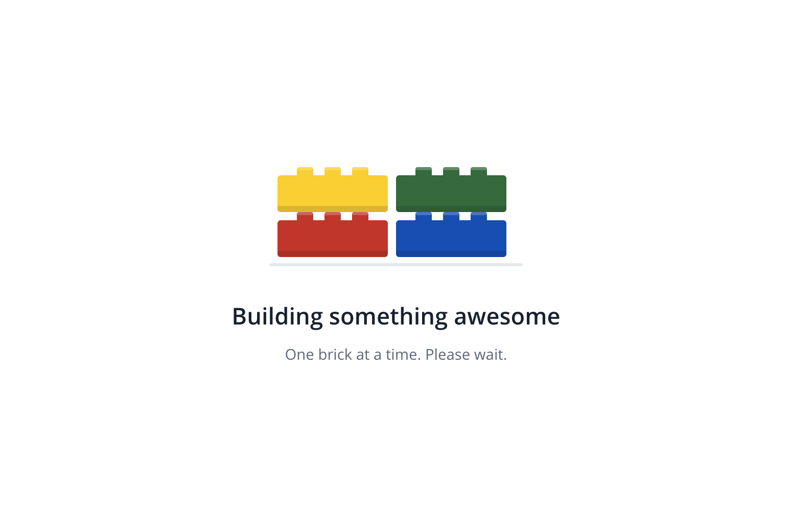

# Brick Loading Animation

A customizable timer-free brick loading animation for Power Apps canvas apps. Four colored bricks assemble above a title and message, providing an indeterminate loading overlay without a Power Apps Timer, JavaScript, external assets, or connectors.

## Preview

The screenshot shows the appearance of the overlay, not proof of live animation playback. SVG animation support varies by browser and Power Apps player; test in the actual desktop browser, tablet, and phone players you intend to support.

## Authors

Snippet | Author(s)
--------|----------
Brick Loading Animation | [April Dunnam](https://github.com/aprildunnam) ([@aprildunnam](https://github.com/aprildunnam))

## Minimal path to awesome

1. Open your canvas app in **Power Apps Studio** in edit mode.
2. Copy the entire contents of [brick-loading-animation.yaml](./source/brick-loading-animation.yaml).
3. In the tree view, select the screen where you want the overlay. Right-click and choose **Paste code** to insert the copied YAML. Paste at screen level, outside short header containers.
4. Ensure the parent provides at least **280 x 360** of space. The root `conBrickLoader` fills its parent, and its inner content is centered.
5. Bring `conBrickLoader` to the front so the white overlay covers the other screen controls. The supplied `Visible = true` is for demonstration, so the overlay appears immediately.
6. For real use, initialize an app loading flag such as `Set(varIsLoading, false)` in `App.OnStart` and set `conBrickLoader.Visible` to `varIsLoading`. Set the flag to `true` before your loading operation and back to `false` when it finishes, including any error path. The snippet does not manage this flag or start any work itself.
7. Preview the app and verify both animation playback and overlay visibility in your target players before publishing.

For reuse, consider placing the snippet inside a canvas component with an appropriately sized parent and exposing the loading state and label text as component inputs.

## How it works

The native Image control `imgBrickLoaderAnimation` renders an inline SVG through a `"data:image/svg+xml;utf8," & EncodeUrl(...)` data URI. SVG `animateTransform` moves each brick into place, while `animate` changes its opacity. All eight animation elements use `dur='3.2s'` and `repeatCount='indefinite'`.

The animation runs continuously while visible. It is **indeterminate**: it does not measure progress, track your loading operation, or signal completion. There is no motion toggle or motion-preference variable in this version. No Timer control, JavaScript, external image assets, uploaded media, or connectors are needed for the loader itself.

SVG media support does not guarantee support for every animation feature in every rendering environment. The supplied YAML and embedded SVG can be parsed structurally, but this is not equivalent to Power Apps compilation or live player verification.

## Customization

Setting | Where to change it
--------|-------------------
Title | `lblBrickLoaderTitle.Text`, initially `"Building something awesome"`.
Message | `lblBrickLoaderMessage.Text`, initially `"One brick at a time. Please wait."`.
Brick colors | Replace matching SVG `fill` values in `imgBrickLoaderAnimation.Image`: red `#D62828`, blue `#0055BF`, yellow `#FFD500`, and green `#237841`. Replace every matching value for each brick, including its studs.
Cycle speed | Replace **every** `dur='3.2s'` consistently in the Image formula to keep the movement and opacity animations synchronized.
Overlay and text colors | Adjust `conBrickLoader.Fill`, `lblBrickLoaderTitle.Color`, and `lblBrickLoaderMessage.Color` to suit your app.
Loading visibility | Bind `conBrickLoader.Visible` to your app's loading flag instead of the demonstration value `true`.

Both labels have `Wrap = false`; keep replacement text short enough to fit and check it at your smallest supported parent size.

## References

- [Image control in Power Apps](https://learn.microsoft.com/en-us/power-apps/maker/canvas-apps/controls/control-image)
- [Add images, audio, or video to a canvas app](https://learn.microsoft.com/en-us/power-apps/maker/canvas-apps/add-images-pictures-audio-video)

## Disclaimer

**THIS CODE IS PROVIDED *AS IS* WITHOUT WARRANTY OF ANY KIND, EITHER EXPRESS OR IMPLIED, INCLUDING ANY IMPLIED WARRANTIES OF FITNESS FOR A PARTICULAR PURPOSE, MERCHANTABILITY, OR NON-INFRINGEMENT.**

