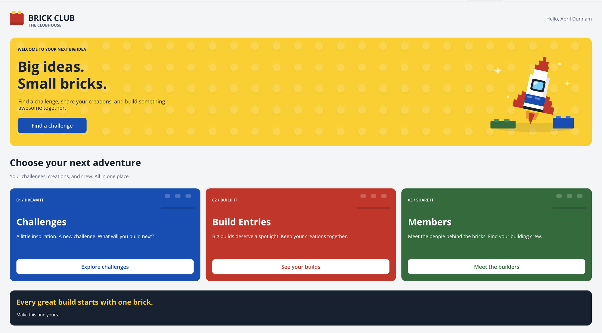

# Clubhouse Welcome Screen

A customizable welcome and landing screen example for Power Apps canvas apps. It combines a brand header, a signed-in-user greeting, a hero with a call to action, three navigation cards, and a closing message. Native labels and classic buttons keep the text and actions editable; inline SVG supplies the decorative logo, patterned background, rocket, and card artwork.

The root container scrolls vertically, the cards switch between a row and a stack, and the hero artwork moves below the text on narrower layouts. The rocket SVG includes a gentle hover and pulsing sparkles, without a Power Apps Timer control.



The supplied screenshot shows the desktop design. It is not evidence of testing across devices or Power Apps players.

## Authors

Snippet | Author(s)
--------|----------
Clubhouse Welcome Screen | [April Dunnam (@aprildunnam)](https://github.com/aprildunnam)

## Minimal path to awesome

1. Open a canvas app in **Power Apps Studio** with support for pasting YAML controls.
1. Under **Settings > Display**, turn **Scale to fit** off.
1. Create a **blank screen**. This snippet supplies a full-parent container, not a screen definition; paste it onto the screen itself, not inside an existing short header, card, or other constrained container.
1. Copy the entire contents of [clubhouse-welcome-screen.yaml](./source/clubhouse-welcome-screen.yaml).
1. In the **Tree view**, right-click the blank screen and select **Paste** or **Paste code**, depending on your Studio version. The root control is `conClubhouseWelcome`.
1. Preview the screen at desktop, tablet, and phone widths. Check scrolling, text wrapping, keyboard focus, and SVG playback in your target browsers and Power Apps players.
1. Select each of the four buttons to see its placeholder notification. Create your destination screens and wire the actions as described below before using this as your app's landing screen.
1. Customize the content and artwork. When ready, set `App.StartScreen` to the actual screen identifier you created, not `conClubhouseWelcome`.

### Requirements and dependencies

The source uses `GroupContainer@1.5.0` (auto-layout and manual-layout variants), `Label@2.5.1`, `Image@2.2.3`, and `Classic/Button@2.2.0`, with `Font.'Open Sans'`. Studio must support these controls and their properties.

No connectors, data sources, collections, uploaded media, external image URLs, HTML controls, custom components, or Timer controls are required by the supplied snippet. The logo and illustrations are SVG data URLs built with `EncodeUrl(...)`. The greeting uses `User().FullName`, and the buttons set the global variable `varHeaderActiveKey`; no separate initialization is required for those placeholder actions.

The Challenges, Build Entries, and Members labels are example destinations, not data bindings. No tables, destination screens, records, or business functionality are included. Add any required data connections and destination-screen behavior in your own app.

### Layout requirements

`conClubhouseWelcome` fills `Parent.Width` and `Parent.Height`, scrolls vertically, and hides horizontal overflow. Keep it on a full-size screen. Its horizontal padding is 16 pixels per side below a root width of 600 pixels and 32 pixels otherwise; the inner `conClubhouseCanvas` uses the remaining width.

Behavior | Formula boundary
---------|-----------------
Three cards in a row | Inner canvas width of 760 pixels or more
Cards stacked vertically | Inner canvas width below 760 pixels
Desktop greeting and large rocket beside the hero text | Inner content width of 900 pixels or more
Smaller rocket below the call to action, with `lblClubhouseHeroSignature` visible | Inner content width below 900 pixels

These boundaries use available control width, not device type or the overall app width. The source declares a minimum supported screen width of **320 pixels**; verify that size in your app rather than assuming runtime compatibility.

Many text labels use `AutoHeight`, and subsequent controls reference their actual bottoms. Hero, card, footer, and scroll-canvas heights follow their content. Brand labels and the greeting have fixed heights and do not wrap; card titles retain a fixed starting position, and buttons have fixed heights. Long replacement text, translated kickers, larger fonts, or a longer narrow-layout signature still need a fit check. Cards can have different heights, and the footer is placed below the tallest card.

### Connect navigation

Each button currently runs `Set(...)` followed by `Notify(...)`. It changes `varHeaderActiveKey` and displays an informational message; it does **not** navigate. Screen names inside those notification strings are illustrative text, not references to existing screens.

Control | Current active-key value | Intended example destination
--------|--------------------------|-----------------------------
`btnClubhouseExplore` | `"Challenges"` | Challenges
`btnClubhouseTile1` | `"Challenges"` | Challenges
`btnClubhouseTile2` | `"Builds"` | Build Entries
`btnClubhouseTile3` | `"Members"` | Members

For each button's **OnSelect**, keep the `Set(...)` and replace only the `Notify(...)` call with `Navigate(...)` using a screen that actually exists. For example, after creating a screen named `scrChallenges`, use this for both `btnClubhouseExplore` and `btnClubhouseTile1`:

```powerfx
Set(varHeaderActiveKey, "Challenges");
Navigate(scrChallenges, ScreenTransition.None)
```

Apply the corresponding destination and key to `btnClubhouseTile2` and `btnClubhouseTile3`. Update the labels and key values together if you repurpose the cards. Clicking a card's background or artwork does not navigate; the actions are on the buttons.

The separate [Brick Club Responsive Header](../brick-club-responsive-header/README.md) is not required or included. Despite the comment in this source about a shared variable, that published header uses `varBrickActivePage`, not `varHeaderActiveKey`. If you combine them, deliberately align the variable names in your app and set the appropriate header state on destination screens; these snippets do not synchronize automatically.

### Customize the welcome screen

Change the following properties in your pasted copy. The contributed YAML is supplied unchanged.

Content | Controls and properties
--------|------------------------
Brand title and subtitle | `lblClubhouseBrand.Text` and `lblClubhouseBrandSub.Text`
Logo | `imgClubhouseLogo.Image`; edit the inline SVG or replace the image formula with your own media
Greeting | `lblClubhouseGreeting.Text`, currently `"Hello, " & User().FullName`; adjust its `Visible` formula if needed
Hero kicker, title, and body | `lblClubhouseHeroKicker.Text`, `lblClubhouseHeroTitle.Text`, and `lblClubhouseHeroBody.Text`; the title uses `Char(10)` for a line break
Hero action | `btnClubhouseExplore.Text` and `.OnSelect`
Hero artwork and background | `imgClubhouseRocket.Image` and `imgClubhouseStudPattern.Image`
Narrow-layout signature | `lblClubhouseHeroSignature.Text`, shown only below the desktop hero boundary
Section heading and subtitle | `lblClubhouseSectionTitle.Text` and `lblClubhouseSectionSub.Text`
Card kickers | `lblClubhouseTileKicker1.Text`, `lblClubhouseTileKicker2.Text`, and `lblClubhouseTileKicker3.Text`
Card titles and descriptions | `lblClubhouseTileTitle1.Text` / `lblClubhouseTileBody1.Text`, `lblClubhouseTileTitle2.Text` / `lblClubhouseTileBody2.Text`, and `lblClubhouseTileTitle3.Text` / `lblClubhouseTileBody3.Text`
Card artwork | `imgClubhouseTileBrick1.Image`, `imgClubhouseTileBrick2.Image`, and `imgClubhouseTileBrick3.Image`
Card actions | `btnClubhouseTile1`, `btnClubhouseTile2`, and `btnClubhouseTile3`: edit `Text` and `OnSelect`
Footer | `lblClubhouseFooterTitle.Text` and `lblClubhouseFooterSub.Text`

The cards are three explicit containers (`conClubhouseTile1`, `conClubhouseTile2`, and `conClubhouseTile3`), not a gallery driven by an `Items` table. Changing the number of cards requires adapting the layout formulas and footer positioning in your own app.

For a new palette, update native `Fill`, `Color`, hover, pressed, and focus properties as well as the matching fills inside the SVG strings. The main accent colors are yellow `#FFD500`, blue `#0055BF`, red `#D62828`, and green `#237841`; dark text and footer use `#172437`. Changing a container's fill alone does not recolor its SVG artwork.

The rocket hover uses SVG `animateTransform` over 4.5 seconds, and the sparkles use SVG `animate` over 3.8 seconds. For static art, remove both animation elements from the SVG in `imgClubhouseRocket.Image` in your app copy. There is no reduced-motion toggle in the snippet. SVG animation support varies by browser and Power Apps player, so test playback in your target environment.

### Limitations and verification

This is a UI starting point, not a complete app or a reusable component with an input/output contract. The full-name greeting has no time-of-day logic or member lookup, and it is hidden on narrower layouts. Decorative images have empty `AccessibleLabel` values and `TabIndex = -1`; buttons have keyboard focus styling and `TabIndex = 0`. Review accessibility, contrast, reading order, and motion requirements for your own app.

The supplied YAML and inline SVG have been checked for syntax, but this contribution has **not** been compiled or tested live in Power Apps Studio or a runtime player. A successful syntax check does not validate Power Fx, control-version compatibility, layout at every width, or animation playback. Confirm all of these after pasting, especially after replacing content or navigation.

## Disclaimer

**THIS CODE IS PROVIDED *AS IS* WITHOUT WARRANTY OF ANY KIND, EITHER EXPRESS OR IMPLIED, INCLUDING ANY IMPLIED WARRANTIES OF FITNESS FOR A PARTICULAR PURPOSE, MERCHANTABILITY, OR NON-INFRINGEMENT.**


